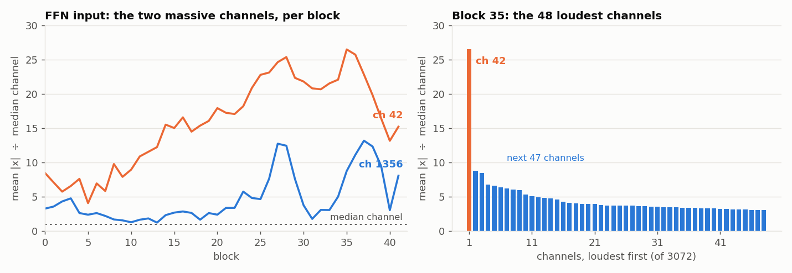
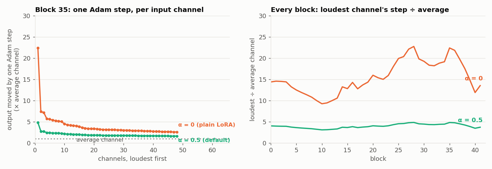
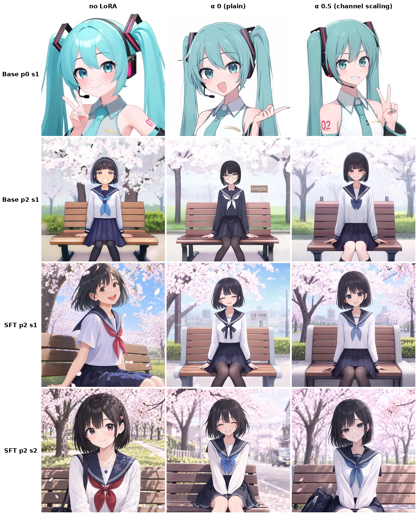
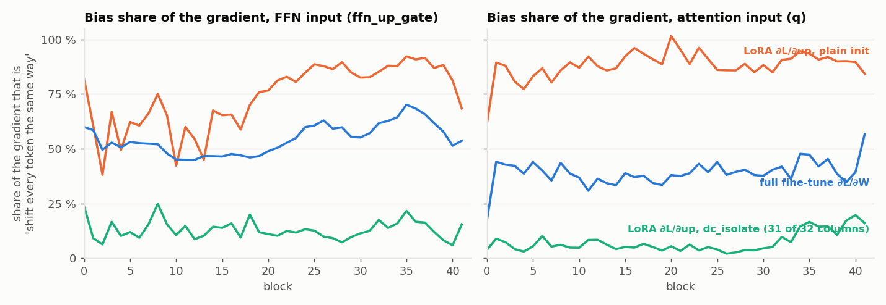

# Channel scaling on MOSS-Image

A training-time fix for one quirk of the MOSS LoRA: a single input channel is 10–25× louder
than every other channel at the FFN input, and AdamW turns it into a bias knob the adapter
reaches for first. Channel scaling rebalances the optimizer's step per input channel. The
forward output is unchanged, the saved file is a plain LoRA, and inference never knows it
was there.

**On by default** (`channel_scaling_alpha = 0.5`, since 2026-10-18, together with lr 1e-4 at
rank 32 / alpha 128). `--channel_scaling_alpha 0` turns it off. GUI: Train step →
`channel_scaling_alpha`. `lora` only; the trainer skips it for `lokr` / `loha`.

| α | effect on the loudest channel's step |
|---|---|
| `0` | off; a plain LoRA |
| `0.5` | shrunk by √(its loudness): 25× → 5× (the default) |
| `1.0` | fully flattened: every channel moves the output the same amount |

## The problem: one channel, 25× louder, on every token

MOSS's residual stream carries a handful of massive-activation channels (1356, 42, …) that
hold almost all of the image tokens' DC offset, the same on every prompt and seed
(`project/moss_lora/dave.md`). RMSNorm and the adaLN modulation damp them before the LoRA
targets see them, but not away: at the FFN input, channel 42 is the loudest of 3072 channels
on blocks 11–41, 11 to 26× the median, and its peak-to-mean is only 2.7, so it is loud on
every token rather than on a few. It behaves like a constant input: a bias line.



Why a constant loud input is a problem for a LoRA trained with AdamW: Adam moves every
weight by roughly the same amount per step, whatever its gradient's size. How much that
moves the output depends on what the weight multiplies. Moving `down[:, c]` by one step
changes the adapter output by about `|x[c]|` × step, so through channel 42 one step moves
the output 25× further than through a typical channel, and does so for every token at
once. The optimizer's cheapest way to lower the loss is to turn that knob: a global shift of
the FFN input on every prompt, before the adapter has learned anything specific to the
style.



## What channel scaling does

Give each input channel a scale `s[c] = mean|x[c]|^α` (normalised to mean 1, from a
calibration file) and fold it into the down projection:

- stored: `down · s`, so the trainable weight on channel `c` is `s[c]` times larger;
- forward: `down · s⁻¹`, so the product is exactly `down · x` as before.

The output is bit-for-bit unchanged, and so is the gradient on `up`. The only thing that
moves is Adam's geometry: a uniform step on the stored weight is a step of `1 / s[c]` on
the effective one, so one step now moves the output by `|x[c]|^(1−α)` instead of `|x[c]|`.
At α 0.5 the loudest channel's lead over the average channel drops from 9–23× to 3–5× on
every block (right panel above). Nothing else changes: same peak memory, same s/step, same loss
curve to three decimals. At save time the file holds `down · s⁻¹`, a plain LoRA; the
metadata stamps `channel_scaling_alpha` as provenance.

The scale sits on the `(rank, in)` weight, not the `(tokens, in)` activation, so there is
no activation-sized op (`library/lines/adapters.py`: `absorb_channel_scale`,
`down_weight`, `channel_scale`).

## What it does in practice

Twin runs on the caststation set (r32 / α128, 20 epochs, `weight_svd`, seed 0), identical
except `channel_scaling_alpha`. The mechanism lands as designed in both: the `down` update
on channel 42 falls from 0.5–1.0× an average column to 0.13–0.25× (≈ 1/s, s ≈ 3.7–4.8),
and the loss curves match.

- **lr 2e-5**: same style strength by eye; the channel-scaled LoRA stays closer to the
  no-LoRA image in 9 / 12 cells (mean pixel distance 49.4 → 43.7). It touches less of what
  the style does not need.
- **lr 1e-4**: by eye clearly better. Plain LoRA at this lr adds things the prompt never
  asked for (glasses and a garbled-text sign, a street with a car in place of the park, a
  broken hand pose); the channel-scaled twin stays on-prompt at the same style strength.
  That is the result the defaults moved on, from lr 2e-5 + α 0 to lr 1e-4 + α 0.5.



Distance to the no-LoRA image measures how much a LoRA changes, not whether the change is
right, so it does not see the lr 1e-4 difference. One seed per cell so far; open items in
`project/moss_lora/channel_scaling.md`.

## What it does not fix: the `up` gradient

Channel scaling only reaches the `down` side. The `up` gradient is `Σ_t g_t · h_tᵀ`, built
from the adapter latent `h = down · x`, and the reparameterisation leaves `h` as it was. That
side has its own version of the same problem, and a bigger one. Because every token carries
the same DC offset, `h` carries a constant component on every token, so a large part of
each step's `up` gradient is "shift every token's output the same way", a bias learner,
spread over all 32 rank directions. Measured with the trainer's loss
(`bench/moss_channel_stats/probe_up_gradient.py`): that bias share is 80–90 % of the `up`
gradient at the FFN and attention inputs, against 40–50 % in the full-fine-tune gradient,
so about half of it is the loss's own and the rank-32 projection concentrates the rest.
Per step the `up` gradient is ~0.8 rank-1, and channel 42's share of it is 3–6× its share
of the full gradient. This is the entanglement GraLoRA (arXiv:2505.20355) describes, and
α does nothing to it.



`--dc_isolate` (experimental, off by default) is the up-side counterpart: the calibrated DC
direction of the input becomes one rank row of `down`, the other 31 rows are kept orthogonal
to it (re-projected after every optimizer step), so one `up` column learns the bias and the
rest get a centered gradient. It does what it says: the bias share on the other 31 columns
drops to 5–12 % (green line). Its one image A/B so far was not better than α 0.5 alone,
with the artist tag rendered as text in 3 / 12 cells, so it stays opt-in. Log and next
steps: `project/moss_lora/channel_scaling.md`.

## Calibration

Two files under `library/moss/calibration/`, both from
`bench/moss_channel_stats/probe_lora_inputs.py` on Base (`_calib_mixed`, 16 samples ×
σ {0.1, 0.3, 0.5, 0.7, 0.9}, the training forward), keyed
`layers.N.proj.{q,k,v,o,ffn_up_gate,ffn_down}` (k / v share q's input):

- `channel_stats.safetensors` (3.9 MB): `mean|x|` per channel, for `channel_scaling_alpha`.
- `channel_mean.safetensors`: the signed token mean `x̄`, for `dc_isolate`.

```bash
make daemon-run ARGS="bench/moss_channel_stats/probe_lora_inputs.py --label <name>"
cp bench/moss_channel_stats/results/<run>/channel_{stats,mean}.safetensors library/moss/calibration/
```

The probe also writes `stats.npz` (per-block dominance, leverage, peak-to-mean),
`dominance.png` and the massive channels' rank at each input; `--model sft` profiles SFT,
and `--channel_stats` / `--channel_mean` on the trainer point at other files. Precision
matters little: `s` is a square root, so a 10 % error in `mean|x|` is 5 % in `s`, and the
adaLN modulation is near-constant over σ 0.1–0.95, so the σ grid need not match training.
Regenerate only if the base DiT changes.

## Code

- `library/lines/adapters.py` — `absorb_channel_scale`, `down_weight`, `channel_scale`,
  `isolate_dc`, `reproject_dc`, `load_channel_stats`;
  `LoRANetwork(channel_stats=, channel_scaling_alpha=, channel_mean=, dc_isolate=)`.
- `library/moss/requests.py` — `TrainRequest.channel_scaling_alpha` / `channel_stats` /
  `dc_isolate` / `channel_mean`.
- `bench/moss_channel_stats/probe_lora_inputs.py` — the calibration probe (both files).
- `bench/moss_channel_stats/probe_up_gradient.py` — the `up`-gradient decomposition
  (`--dc_isolate` to measure the isolated init).
- `tests/test_moss_lora.py` — output equality, gradient `= g · s⁻¹`, plain-LoRA round
  trip; the `dc_isolate` orthogonality / re-projection / round-trip test.
